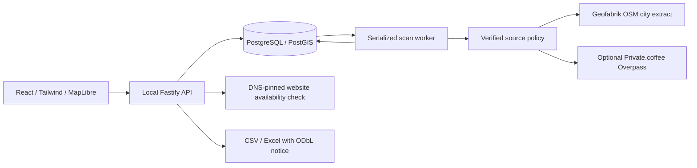
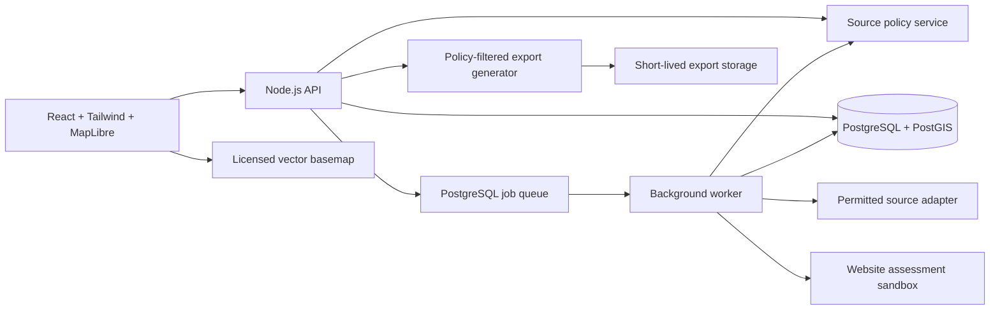

# Implemented MVP architecture

The runnable application is a single local Fastify/TypeScript server and React/Vite frontend. PostgreSQL 16/PostGIS 3.4 runs in the project Docker container. The background worker runs in the same Node process and claims PostgreSQL scan rows every second. This intentionally replaces the earlier proposed pg-boss/multi-service setup for the bounded solo pilot.



`shared/catalog.ts` defines cities, categories and contracts. `server/discovery.ts` compiles bounded online queries and persists OSM identities. `server/local-source.ts` loads snapshot-matched city bundles. `scripts/extract-city.py` caches Metro Manila boundaries and named business candidates once per source checksum; the candidate window is derived from supported city polygons. `scripts/local_spatial.py` uses vectorized city containment and a Shapely STRtree for all overlapping subarea memberships. First indexing can take a few minutes; future city preparation uses the small index and scans use cached city bundles. Makati is pilot-tested; bounded dental scans in Quezon City and Pasig also passed performance validation.

`server/preparation.ts` shares concurrent same-city preparation, serializes different-city work and isolates caller cancellation. Python subprocesses emit actual stages and have an eight-minute deadline. A cancelled caller leaves reusable preparation available to other callers. Snapshot checksums and index schema/bounds control cache reuse; generated JSON files are replaced atomically.

`server/worker.ts` claims a single job, checks area membership, stores bounded results with source evidence and retains completed partial writes on cancellation. API queue mutations use a transaction/advisory lock; OSM type/id uniqueness deduplicates retries. Restarted active scans resume safely. Operation is single-process; additional server replicas require shared concurrency/rate coordination.

Local mode binds loopback and checks Host/Origin. Private hosted mode requires an exact HTTPS origin and HTTP Basic credentials; the production Compose stack exposes only Caddy's TLS proxy and protects all UI/API routes. Cross-origin writes and cross-site requests are denied. Persistent volumes hold PostGIS and source data. Website checks resolve every redirect, reject private/reserved addresses, pin vetted DNS, bound time and block nonstandard ports. They measure availability, not design quality. Missing website fields are uncertain.

The map-first frontend uses 50-record list pagination and an independent map endpoint capped at 10,000 matching points with explicit completeness metadata. Shared validated filters govern list/map/export. UUID detail requests allow selection beyond the current page. MapLibre clusters points; synchronized catalog and protected-focus sheets expose records, filters and scans. Social links normalize explicit source evidence, retain provenance and appear in records/exports. Stale-response guards and skeleton/spinner states cover search, selection and actions; unsaved drafts survive switching records.

Active scans poll every second, show elapsed time and actual preparation stages, and announce terminal outcomes. Starting a scan clears stale record filters and scopes results to its city/category. MapLibre is lazy loaded; the approximately 1 MB map chunk is separate from the primary app. Streets are opt-in; local mode can use community OSM tiles while hosted mode requires a reviewed configured provider. Automated checks block community tiles. See DEPLOYMENT.md for the tested container setup and recovery workflow.

The original detailed proposal below is retained as a future expansion reference; it is not the implemented service topology.

---

# Technical architecture proposal

Status: planning artifact, not a running application. Source decisions are governed by SOURCE-POLICIES.md. The proposed pilot is Makati with OSM data; city and audience remain open user choices. No bulk scanning is enabled.

## System shape

Use an npm workspace with a React/Vite frontend, a TypeScript Node.js API, a separate background worker, and shared policy/contracts packages. PostgreSQL holds application data; PostGIS provides geographic containment and indexes. Propose pg-boss for PostgreSQL-backed jobs so the MVP does not require Redis. Validate the selected queue/PostgreSQL versions when scaffolding. A later high-throughput migration to BullMQ/Redis is optional, not an MVP dependency.



Suggested layout:

```text
apps/web/                 React routes, query state, forms, table, map
apps/api/                 HTTP API, auth, authorization, transactions
apps/worker/              discovery, assessment, cleanup, export jobs
packages/contracts/       validated request/response schemas
packages/policies/        capability and field decisions
packages/sources/         adapter contract, OSM adapter, fixture adapter
packages/db/              migrations and query helpers
packages/website-checks/  URL/DNS/redirect validation and classifications
database/                 schema proposal and geography import specification
docs/                     source research, architecture, design brief, roadmap
```

The API is the authority for permissions; hiding a button in React is insufficient. Background tasks also check permissions. Use Zod-compatible contracts, server pagination, and structured errors. Use Fastify as a proposed API framework and SQL migrations/query helpers as the initial data layer; these are implementation recommendations.

## Workflows and API boundaries

| Interface | Purpose | Enforcement |
|---|---|---|
| `GET /api/areas` and `/api/district-definitions` | Current verified city/barangay areas and explicit district membership | Return provenance/version; do not present unverified geometry as searchable |
| `GET /api/categories` | Built-ins plus custom categories and supported source mappings | Unsupported custom category gets a reason, not silently broadened matching |
| `POST /api/scans/preview` | Resolve area/category/source, estimate requests, show permissions and ceilings | No business query; deny unknown/suspended/expired policy or boundary |
| `POST /api/scans` | Create a bounded scan with an idempotency key and transactional queue/outbox | Requires current policy and permit, approved geography and reserved quota |
| `GET /api/scans/:id` and `POST /api/scans/:id/cancel` | Stage counts, partial results, task failures, cooperative cancellation | Owner/workspace checks; no restricted payloads in progress messages |
| `GET /api/businesses` | Search/filter/sort, cursor pagination, compact map features | Current field/map policy, geographic filters, provenance, no forbidden cross-source merge |
| `GET /api/businesses/:id` | Source facts, website evidence, confidence, permitted public contacts | Workspace authorization, freshness and retention filtering |
| `POST /api/prospects` and `PATCH /api/prospects/:id` | Save status/notes and operator decisions | Optimistic version check, audit actor, source prospecting rights |
| `POST /api/website-assessments` | Queue one permitted website assessment | Website URL provenance and source enrichment permission; strict network validation |
| `POST /api/exports/preview` and `/api/exports` | Explain allowed/excluded fields and rows; generate CSV/XLSX bundles | Recheck per-field license/recipient/expiry rules at preview, generation, and download |
| `GET /api/sources` | Permission summaries, verification, attribution and quotas | Administrative changes audited; ordinary users cannot self-authorize policy |

Filter state lives in the URL; a shared server query feeds list and map. Map panning does not issue source discovery. An explicit “Search this area” starts with preview. Map queries use viewport-bounded/clustering responses and independently computed allowed coordinates. Never spatially process Google Places coordinates under standard terms.

Use polling with backoff for the MVP job view (or SSE if straightforward); show stage counts and unknown totals honestly. Status values include planned, queued, running, partial, completed, failed, and cancelled. A running scan with some successful tasks remains partial if others fail. Cancellation stops future tasks and discards prohibited persistence, while permitted discoveries already committed stay recorded with accurate scan membership.

## Geographic model

Store versioned administrative areas with names, reference codes as text, geometry, boundary source, and verification. Include the 16 cities and Pateros as LGUs; barangays have an LGU parent. Store districts separately with definition kind, validity dates, geometry where permitted, and membership. NCR groupings and congressional/local districts need different models and labels.

Use PostGIS `ST_Covers`/spatial indexes for permitted POI containment and treat overlapping/boundary points as review cases. OSM way/relation centers can be approximate representative points; retain location method and confidence. A source address and geometric assignment are separate facts. Preserve unknown barangay rather than guessing. Historical area membership uses the scan's boundary version.

The schema accommodates the full metro region from the start, but only the validated pilot geometry is active initially. Do not fabricate PSGC codes or a current barangay count; the official reference was not retrievable during research.

## Category discovery

Built-in adapter rules cover, after current OSM-tag validation:

| Category | Initial OSM mapping proposal |
|---|---|
| Restaurants | `amenity=restaurant` |
| Dental clinics | `amenity=dentist` |
| Clothing boutiques | `shop=clothes`, then human review for boutique distinction |
| Beauty salons | `shop=beauty` or `shop=hairdresser`, separately label subtype |
| Gyms | `leisure=fitness_centre` |
| Automotive services | `shop=car_repair`, `shop=tyres`, `amenity=car_wash` |
| Schools | `amenity=school`; other education types explicitly opt in |
| Other/custom | Validated structured tag rules or provider category mappings |

Custom labels do not magically add source coverage. Never interpolate arbitrary user-supplied Overpass QL. Compile allowlisted keys/operators/values and verified geometry into bounded queries. Unmapped categories can be used for manual classification but show discovery as unsupported. Store mapping/schema versions and multi-category membership.

## Discovery and deduplication

The worker validates the active policy and scan permit, reserves request/byte/spend limits, compiles a bounded area/category query, calls the configured endpoint, checks cancellation/policy again, and validates the response before persistence. No unknown adapter writes through generic JSON storage.

OSM identity uses element type plus ID; releases and source IDs remain source-specific. Exact repeat identities upsert permitted fields and create an observation without duplicating a business. Matching different elements or providers uses name/address/domain/distance evidence only where processing and mixing are allowed. Probable matches become reviewer candidates; preserve branches at different locations and do not auto-merge solely by name. All merges are reversible and retain provenance.

The durable business ID is an application identifier. The displayed name/location/contacts come from selected policy-permitted observations, not an untraceable canonical overwrite. Cross-source enrichment must not turn restricted fields into “manual” or “OSM” facts.

Raw response retention is optional and defaults off. If allowed, store only the approved payload, retention deadline and encrypted location; otherwise normalize permitted fields in memory and discard the raw response. Exclude business payloads, contacts, credentials, and raw provider content from queue messages and ordinary logs.

## Website detection and opportunity ranking

Separate observed URL evidence, reachability assessment, human review, and CRM status. A listing with no website field is not proof of absence. Store `not_assessed` internally in addition to the five requested display classifications.

| Classification | Evidence and behavior |
|---|---|
| No website | Manual/independently supported decision with evidence, review time and scope; automatic missing-field cases display “No website listed” and require review |
| Existing website | A permitted business-site URL responded successfully; does not imply quality or ownership is fully verified |
| Website unavailable | Bounded repeated attempts show DNS/TLS/timeout/HTTP failure; display reason and time, retain URL; one blocked request stays inconclusive |
| Website needs review | Missing/conflicting URL, ambiguous ownership, parked page, redirect mismatch, inconclusive response, or a human quality concern |
| Social media only | Source lists only recognized social profiles; phrase as source evidence, not proof no separate site exists |

Use parsed hostname matching (including exact hostname/subdomain rules) for social domains, not substring matching. Separate marketplace/directory/order-platform URLs from social and first-party business domains. Evidence explains what was actually checked; WAF/403/429 are inconclusive and must not lower a business's opportunity confidence as if offline.

Initial website jobs use HEAD with bounded GET fallback only when needed, public HTTP/HTTPS, no login, no CAPTCHA bypass, no deep crawling, no screenshots/HTML archive by default. Optional permitted public-site metadata checks must respect site terms and robots directives where relevant; they are not needed for the first reachability MVP. A reachable page is not automatically a modern site; aesthetic quality remains manual review in the MVP.

Proposed transparent ordering tiers: manually confirmed no site, source-listed social only, repeated unavailable site, review required, reachable site, not assessed. Missing-field/inconclusive cases never rank as confirmed no-site. Confidence is shown separately; ties use evidence freshness and business name/ID. Final weights/tier order are reviewable, versioned and displayed through reason codes, with no claims about conversion probability. Store derived assessments only when their inputs and source permit it.

## Website network security

Discovered URLs are untrusted. Restrict to HTTP(S), ports 80/443, no embedded credentials, and a bounded URL length. Resolve all A/AAAA records and reject private, loopback, link-local, reserved, multicast, mapped-private IPv6, cloud metadata, and internal destinations. Validate every redirect and cap hops; do not let the HTTP client re-resolve an approved hostname to a private address. Pin the validated address while preserving hostname/SNI and TLS validation. Enforce outbound network controls as defense in depth.

Use connect/read/total timeouts, body-size limits, domain concurrency/rate limits, jittered bounded retries, and a separate worker network context with no access to database/metadata services except through the required controlled service path. A blocked request produces a typed assessment error, not an application failure or leak. Never accept arbitrary command execution, downloads, schemes, or raw HTML as trusted UI.

## Persistence and license boundaries

`database/schema.sql` is a reviewable schema proposal. It separates:

- source policies, permissions, field allowlists, evidence, permits and quota accounting;
- versioned areas/districts and category mappings;
- durable source records/observations with field provenance and retention;
- application business identities and permitted links;
- URL evidence and website assessments with input provenance;
- operator prospects, notes, and audit history;
- scans, tasks, memberships, export jobs, and deletion events.

This separation makes rules enforceable and auditable; it does not itself settle ODbL independence or a proprietary provider contract. No Google payload is stored in the generic durable-source schema while its adapter is rejected. Policies default to no capability. Database constraints assist integrity, but API/worker policy checks remain necessary for per-field licensing and derived data lineage.

## Export and retention

Exports run on the server. The preview shows allowed rows/columns, exclusions/reasons, source bundle, observation dates, and recipient rights. The worker rechecks current policy and retention at serialization; revocation cancels the job and prevents later downloads. Generate short-lived files with ownership checks and audited download; do not put restricted fields into filenames, cached counts, or debug logs.

CSV uses UTF-8, robust quoting/newline handling, and formula-injection escaping for values beginning with dangerous spreadsheet prefixes, including leading whitespace/control characters. XLSX uses explicit text cell types for untrusted names, notes, phone numbers, identifiers and URLs; no active formulas from user/source strings. Export license/attribution manifest accompanies CSV in a ZIP bundle; XLSX has a visible Sources/Licenses sheet and associated license files where required. Preserve phone numbers and codes as text.

The OSM-derived distribution and independent CRM export stay separate until derivative/collective treatment is verified. A single-source export is not automatically exempt from license obligations. Files and backups have documented TTL/deletion handling; removal tasks erase expired source facts and assessments/scores derived solely from them, invalidate generated files, and preserve only permitted minimal audit metadata. Backup restoration reapplies deletion tombstones before service. Provider revocation/deletion rules supersede ordinary retention defaults.

## Security and operations

Propose single-organization authentication for the MVP, with owner/operator roles and workspace ownership. Keep credentials on the server, restrict API keys, validate inputs, enforce object-level authorization and rate limits, and audit policy/CRM changes. Use CSRF protection for cookie auth, secure cookie settings, same-origin deployment/CORS restrictions, and sanitization of notes and URLs. Team/tenant expansion introduces tested row-level isolation before onboarding a second organization.

Expose health/readiness, structured task state, provider request counts/bytes/cooldowns, classification outcomes, and policy denials without contact/payload leakage. Maintain an application kill switch for discovery, website checks, exports and scheduling. Retry only transient failures with a bounded budget; queue retries are separate from provider quota reservations. A killed/restarted worker resumes through task idempotency and unique source identities, not exactly-once assumptions.

Local development proposal: frontend/API/worker plus a PostGIS container, with permitted fixture adapter as default. Production proposal: a web service/API, dedicated worker, managed PostGIS-capable PostgreSQL, and short-lived export storage; hosting and budget remain open. Pg-boss uses its own schema. Version migrations, source policies and geography imports. Local fixture tests never consume provider quotas.

## Required validation

Meaningful tests cover policy denial/expiry/revocation at every boundary; cross-source provenance; duplicate/idempotent delivery and cancellation; licensed field deletion; SSRF/redirect/DNS-rebinding cases; uncertainty classification; formula-safe exports; unauthorized object access; geography overlaps/membership; scan partial/recovery states; and map/list filter consistency. UI verification includes first run, one long/missing-field record, dense results, partial/quota failures, keyboard operation, desktop/mobile and basemap failure.

Do not run an exhaustive live city crawl as a test. Pilot acceptance and metropolitan rollout gates are defined in ROADMAP.md.
