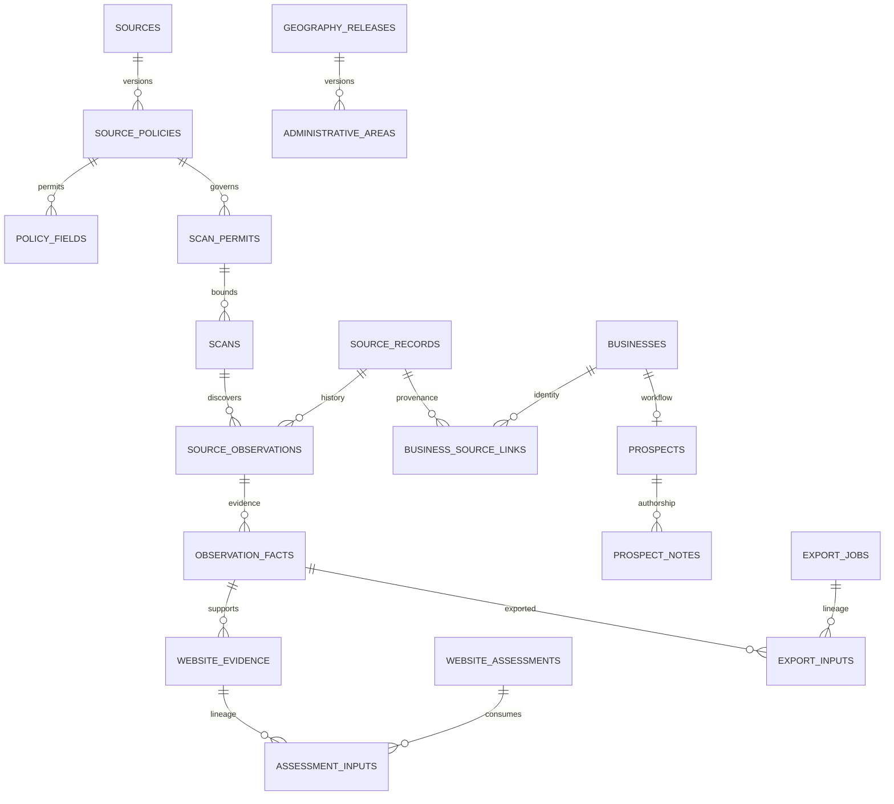

# Applied MVP database

The active schema is `database/migrations/001_mvp.sql` plus `002_local_source.sql`, applied by `server/migrate.ts` to the local Docker database. `database/schema.sql` remains a larger, unapplied future design. Do not apply it over the MVP database.

- `businesses`: source facts, OSM type/id identity, coordinates/PostGIS point, tags, website status and observation time.
- `prospects`: independent operator-authored status and notes, preserved during refresh.
- `scans` and `scan_businesses`: bounded scope, job lifecycle, source timestamp/transport and exact discovered record links.
- `geo_cache`: verified OSM relation/subareas and their transport.
- `website_checks`: timestamped availability observations.
- `source_requests`: optional Overpass request budget/audit.
- `scanner_migrations`: applied migration ids.

The local extract manifest and city bundles reside in ignored `.local-data/`. Each imported record includes transport, extract hash and data timestamp. Current refresh updates source facts rather than retaining all historical raw snapshots in PostgreSQL. Backup with `pg_dump` and retain the extract manifest/PBF for reproducibility.

The API derives normalized `social_links` from retained source tags, the legacy social field and recognized social website URLs. Each link carries its source field; this upgrade requires no additional database migration or social-account inference.

The following document describes the future expanded provenance schema, not tables currently running.

---

# Database proposal

The [schema](../database/schema.sql) is reviewable DDL for PostgreSQL 16+ and PostGIS 3.x. It has not been applied. It creates no business records, source approvals, geography releases, or scan permits. Validate actual server/extension/queue versions and turn this proposal into versioned migrations during implementation.

## Identity and source facts

`businesses` contains application identity, not an untraceable copy of a provider's name, address, or contacts. `source_records` retains the permitted external identifier and namespace; OSM node, way, and relation IDs remain distinct. Versioned observations hold named facts with policy, transformation, observation time, and retention deadline. Multiple website/phone values use ordinals. Exact repeated identities and observations are unique; link history supports reviewed, reversible matching without automatically merging separate branches.

Website URL evidence, assessments, request attempts, and opportunity rankings are separate from prospect status and operator-authored notes. Assessment inputs identify the facts that support a result. A `no_website` classification requires a human reviewer and scope; missing source fields go to review. Application validation also requires evidence, validates reason codes, enforces consistent outcome/classification pairs, and prevents stale results from being displayed as current. Status `contacted` records an operator action; the MVP sends no outreach.

The normalized fact model preserves license lineage. It is not permission to persist arbitrary JSON: validate every field against a typed adapter contract and its current field policy, and never place an entire provider response in `value`. Raw payload storage defaults off. Denormalized search/map caches, if later added, must carry the same provenance, expiry, and deletion behavior.

## Geography and categories

Reference codes are text. A geography release identifies separate reference and boundary sources/licenses. Same-release composite keys prevent mixing historical and current area/district memberships. Districts are explicitly typed, not a universal intermediate administrative level. Geometry is nullable until independently verified; live discovery requires valid, authorized geometry. Parent kind/cycle validation, district membership semantics, and the current Makati/Taguig assignments belong in the importer and acceptance tests.

Location facts produce indexed representative points only when spatial processing is permitted. Multiple candidate area assignments can require review; a point on a shared boundary does not force a guessed barangay. Category mappings are versioned structured rules, never arbitrary Overpass query text. Validate that custom categories belong to the requesting workspace and that mappings/evidence correspond to the selected source.

## Permissions, jobs, and integrity

Capabilities default to false; missing rows also mean denied. Field storage requires an explicit retention limit or verified unlimited retention. An approved source policy needs reviewer and review-due metadata. `sources.current_policy_id` must refer to its own revision. Policies become immutable after verification; changes create a new revision, while source suspension takes immediate effect. Service roles and application transactions must enforce immutability and authority to approve policies.

Scans pin source, policy, permit, and geography versions, with composite foreign keys binding them together. API/worker validation additionally verifies current approval/expiry, endpoint and permitted geographic scope, categories, quota, record limits, field rights, and cancellation before each stage. SQL does not perform legal interpretation or external network enforcement. Quota reservations use row locks across the shared endpoint/account window and the scan's own ceilings; enforce a streaming byte limit and persist truthful usage even when an estimate is exceeded.

Queue delivery is at least once. Unique scan/task/request/observation keys make recovery idempotent. Queue payloads contain identifiers and task parameters without provider data or contacts; pg-boss owns its separate schema. Add a transactional outbox or use the queue's documented transaction interface after validating its chosen version. `updated_at`, optimistic `version` increments, state transitions, and audit insertion are explicit application transactions, not implicit effects of these columns.

Composite workspace foreign keys protect many relationships. Single-organization deployment still needs authenticated object-level checks and restrictive database roles; this schema does not implement RLS or prove tenant isolation. Add and test RLS plus complete tenant-scoped uniqueness before multi-organization deployment. Category ownership, quota/source correspondence, fact-to-business links, and assessment lineage are further invariants the service must validate.

## Deletion and exports

Retention cleanup traverses observation facts to website evidence, assessments, rankings, category/location derivatives, and export inputs. Cascading an input link alone does **not** delete its parent assessment: invalidate/delete affected derived results explicitly in the same cleanup workflow. Export input foreign keys intentionally require revoking/removing dependent objects before deleting facts. Object-store removal and database updates need retryable cleanup tasks; do not treat a DB transaction as atomic with file deletion.

Preserve minimal permitted audit/deletion metadata, never deleted provider facts. A restore must apply tombstones before reopening service. Review backup TTL, externally downloaded exports, operator notes quoting source data, and provider termination conditions separately. Source-table/CRM-table separation supports provenance but does not itself settle ODbL or contractual independence.

## Migration validation gate

During MVP setup, apply migrations to a disposable PostGIS database and verify foreign keys, uniqueness, checks, source revision ownership, workspace mismatch rejection, geography release consistency, and an idempotent fixture run. Prove revocation/deletion traversal and object invalidation with fixtures. Schema syntax parsing can be checked without connecting to a database, but does not verify PostGIS availability, referenced keys, runtime queries, or permission enforcement.

Planning validation on 2026-11-24: pglast v8.9 parsed all 58 statements across 41 tables successfully, and a static AST check found valid column/referenced-key declarations for all 83 foreign keys. This is not database execution: no PostgreSQL/PostGIS server was used and the DDL has not been applied. The local parser package is a development validation dependency excluded from version control and application images. [Validation result](validation/schema-result.json) records this limited scope. Reproduce with `python docs/validation/validate-schema.py` after installing the pinned pglast 8.9 parser into `docs/validation/vendor/`.
